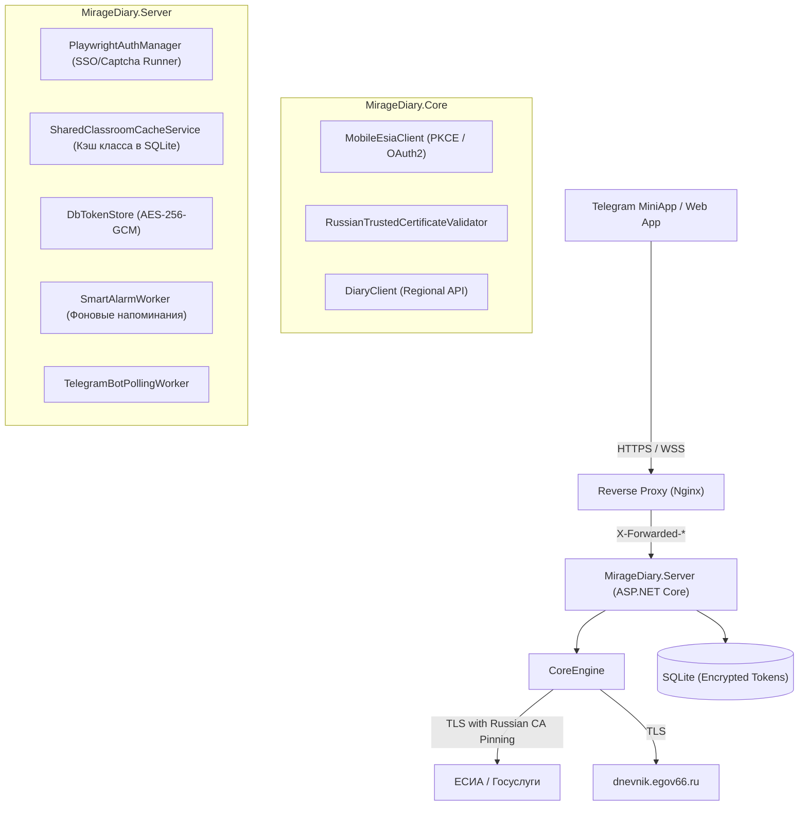

# MirageDiary (DiaryEgov66ru)

Высокопроизводительный бэкенд-сервис и Telegram MiniApp для интеграции с региональным электронным дневником (`dnevnik.egov66.ru`) и ЕСИА/Госуслугами.

---

## 🏛 Архитектура решения

Решение построено на платформе **.NET 10 (ASP.NET Core)** с разделением на специализированные слои:



### Проекты в решении

* **`MirageDiary.Core`**: Базовая библиотека протоколов и моделей:
  * `MobileEsiaClient`: Прямой протокол мобильного шлюза ЕСИА (PKCE S256 OAuth2), не требующий запуска браузера.
  * `RussianTrustedCertificateValidator`: Строгий валидатор цепочки доверия X.509 с проверкой отпечатков корневых сертификатов Минцифры (Russian Trusted Root CA).
  * `DiaryClient`: HTTP-клиент к региональному API дневников с пулингом соединений и защитой от таймаутов.
* **`MirageDiary.Server`**: Серверная часть:
  * REST API и обратный прокси для фронтенда (`MiniAppController`, `DiaryProxyController`).
  * Telegram & MAX боты (`BotCommandService`, `MaxCommandService`).
  * Управление сессиями и фоновый рефреш токенов (`TokenRefreshBackgroundService`).
  * Безопасное шифрование токенов в БД (конвертное шифрование HKDF + AES-256-GCM `enc:v2:`).
* **`MirageDiary.MiniApp`**: Клиентский интерфейс Telegram WebApp (React / Vite), расположен в отдельном репозитории [MirageDiary-Miniapp](https://github.com/Miragestudio-repo/MirageDiary-Miniapp). Скомпилированные статические файлы размещаются в `MirageDiary.Server/wwwroot/`.

---

## 🔒 Модель безопасности

1. **Валидация сертификатов Минцифры**:
   * Никаких «слепых» `return true`. Валидатор сверяет отпечатки SHA-256/SHA-1 сертификатов удостоверяющего центра Минцифры и проверяет доменные границы (защита от MitM и спуфинга).
2. **Шифрование данных пользователей (AES-GCM-256)**:
   * Все токены доступа и рефреш-токены шифруются перед записью в базу данных.
   * Мастер-ключ задается через переменную окружения `MIRAGE_TOKEN_ENCRYPTION_KEY`. При генерации локального ключа файл защищается правами доступа операционной системы.
3. **Защита ресурсов сервера (Playwright Concurrency Limiter)**:
   * Запуск Headless-браузера для обхода капчи ограничен семафором (`SemaphoreSlim`), защищая сервер от истощения оперативной памяти при пиковых нагрузках.
4. **CORS и защита заголовков**:
   * Включен строгий CORS с ограничением доверенных источников (`web.telegram.org` и домены дневника).

---

## 🚀 Быстрый старт

### Требования
* [.NET 10 SDK](https://dotnet.microsoft.com/download/dotnet/10.0)
* Node.js 20+ (для сборки MiniApp, опционально)

### Сборка решения

```bash
dotnet restore MirageDiary.slnx
dotnet build MirageDiary.slnx -c Release
```

### Настройка переменных окружения

| Переменная | Описание | Пример |
|---|---|---|
| `MIRAGE_TOKEN_ENCRYPTION_KEY` | 32-байтный мастер-ключ шифрования (AES-256) | Base64-строка (32 байта) |
| `Telegram__BotToken` | Токен Telegram-бота из BotFather | `123456789:ABC...` |
| `Playwright:ExecutablePath` | Путь к Chromium (опционально) | `/usr/bin/chromium` |

### Запуск сервера

```bash
cd MirageDiary.Server
dotnet run
```

---

## 📄 Лицензия
Private / Educational project.